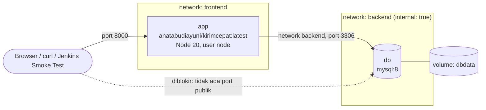

# KirimCepat: Dokumentasi Container Engineer

Dokumentasi kerja **Container Engineer** untuk Tugas Besar 1 DevOps (CI/CD Pipeline Jenkins), studi kasus **K13 KirimCepat**.

| | |
|---|---|
| Nama | Anata Budi Ayuni (102062400041) |
| Peran | Container Engineer |
| Repo kelompok | https://github.com/ZendayGT/KirimCepat (branch `container/hardening`) |
| Image Docker Hub | https://hub.docker.com/r/anatabudiayuni/kirimcepat (tag `1`, `latest`) |
| Stack | Node.js 20 (Express) + MySQL 8, Docker Compose |

Repo ini menyimpan salinan file container, penjelasannya, dan **output asli** dari setiap pengujian (folder [`bukti/`](bukti)). Kode aplikasi tetap berada di repo kelompok.

---

## 1. Tanggung jawab Container Engineer

Menurut panduan tugas, tanggung jawabnya adalah **Dockerfile, compose.yaml, .env.example, dan healthcheck**. Buktinya di laporan berupa isi file dan output `docker compose ps`. Komponen nilai terkait: **Containerization 15%**.

### Checklist ketentuan B (Container)

| Ketentuan | Status | Di mana |
|---|---|---|
| Dockerfile ditulis sendiri, multi-stage, ada stage `test` | ✅ | [`container/Dockerfile`](container/Dockerfile) |
| compose.yaml minimal 2 service (app + database) | ✅ | `app`, `db` |
| Network backend `internal: true` | ✅ | [`bukti/05`](bukti/05-isolasi-network.txt) |
| Volume untuk data database | ✅ | `dbdata`, [`bukti/07`](bukti/07-persistensi-volume.txt) |
| Healthcheck pada database | ✅ (juga pada app) | [`bukti/03`](bukti/03-compose-ps.txt) |
| `depends_on` dengan `condition: service_healthy` | ✅ | `app` menunggu `db` healthy |
| `restart: unless-stopped` | ✅ | [`bukti/08`](bukti/08-user-tz-restart.txt) |
| Image dari Docker Hub (`image:`, bukan `build:`) | ✅ | `anatabudiayuni/kirimcepat:latest` |
| Rahasia di `.env`, `.env` di `.gitignore`, ada `.env.example` | ✅ | [`bukti/10`](bukti/10-git-env-aman.txt) |

---

## 2. Arsitektur container



- **app** ikut dua network. Lewat `frontend`, port 8000 bisa diakses dari host. Lewat `backend`, app bisa menghubungi database.
- **db** hanya ada di `backend`. Network ini `internal: true`, jadi db tidak bisa diakses dari host dan tidak punya akses internet.
- Data MySQL disimpan di volume bernama `dbdata`, sehingga tetap ada walaupun container dihapus.

---

## 3. Daftar pekerjaan (step + penjelasan)

### Step 1: Dockerfile multi-stage
File: [`container/Dockerfile`](container/Dockerfile)

```dockerfile
FROM node:20-alpine AS base      # stage 1: install semua dependency
WORKDIR /app
COPY package*.json ./
RUN npm ci

FROM base AS test                # stage 2: jalankan test di dalam container
COPY . .
RUN npm test

FROM node:20-alpine AS prod      # stage 3: image produksi yang ramping
RUN apk add --no-cache tzdata
ENV TZ=Asia/Jakarta NODE_ENV=production
WORKDIR /app
COPY package*.json ./
RUN npm ci --omit=dev
COPY src ./src
COPY migrations ./migrations
USER node
EXPOSE 8000
CMD ["node", "src/server.js"]
```

| Bagian | Alasan |
|---|---|
| Stage `test` | Jenkins cukup menjalankan `docker build --target test`. Mesin Jenkins tidak perlu memasang Node.js. Jika test gagal, build gagal, dan itu yang menjadi *quality gate*. |
| Stage `prod` dari base image bersih | Tanpa devDependencies (jest, supertest) dan tanpa folder `tests`. Image prod **211 MB**, sedangkan image test **313 MB** ([`bukti/02`](bukti/02-image-size.txt)). |
| `node:20-alpine` | Base image kecil, dan Node 20 didukung Azure App Service (untuk Tubes 2). |
| `npm ci` | Instalasi persis sesuai `package-lock.json`, sehingga hasilnya sama di laptop maupun di Jenkins. |
| `TZ=Asia/Jakarta` + `tzdata` | Nomor resi memakai tanggal (`KC` + YYYYMMDD + urut). Tanpa ini, container memakai UTC, sehingga resi yang dibuat jam 00.00–07.00 WIB akan bertanggal kemarin. |
| `USER node` | Aplikasi tidak berjalan sebagai root. Jika aplikasi dibobol, penyerang tidak mendapat hak root di dalam container. |
| `CMD node src/server.js` | `server.js` menjalankan migrasi dan seeder dulu, baru `listen`. Jika migrasi gagal, proses berhenti lalu di-restart oleh Docker. |

### Step 2: `.dockerignore`
File: [`container/.dockerignore`](container/.dockerignore)

Stage `test` memakai `COPY . .`. Tanpa `.dockerignore`, file **`.env` berisi password** akan ikut masuk ke image, begitu juga `node_modules` dari laptop dan folder `.git`.

### Step 3: compose.yaml
File: [`container/compose.yaml`](container/compose.yaml)

| Bagian | Alasan |
|---|---|
| `name: kirimcepat` | Nama project tetap. Jenkins Multibranch menaruh kode di folder workspace yang namanya acak, sehingga tanpa ini nama volume dan network akan berubah-ubah dan data DB bisa "hilang". |
| `image: anatabudiayuni/kirimcepat:latest` | Yang di-deploy adalah image hasil pipeline dari Docker Hub, bukan hasil `build:` lokal. |
| `env_file: .env` | Konfigurasi dan password dibaca dari `.env` yang tidak di-commit. |
| Healthcheck **app** (`wget /health`) | `docker compose ps` menampilkan app *healthy* hanya jika aplikasi benar-benar melayani request dan tersambung ke DB, tidak cukup hanya prosesnya hidup. |
| Healthcheck **db** (`mysqladmin ping -h 127.0.0.1`) | Memakai TCP (`127.0.0.1`), bukan socket (`localhost`). Saat inisialisasi pertama, MySQL menjalankan server sementara lewat socket, sehingga `localhost` bisa terbaca healthy terlalu cepat. |
| `depends_on: condition: service_healthy` | App baru dijalankan setelah MySQL siap menerima koneksi, jadi migrasi tidak gagal. |
| Network `frontend` + `backend (internal)` | Isolasi database (lihat Arsitektur). |
| Volume `dbdata` | Data persisten. |
| `restart: unless-stopped` | Container hidup lagi otomatis jika crash atau server reboot. |
| `TZ: Asia/Jakarta` | Waktu di app dan MySQL (`CURRENT_TIMESTAMP`, `CURDATE()`) memakai WIB. |

### Step 4: Manajemen rahasia (`.env`)
Files: [`container/.env.example`](container/.env.example), [`container/.gitignore`](container/.gitignore)

- `.env` (berisi password asli) ada di `.gitignore`, sehingga **tidak pernah di-commit** ([`bukti/10`](bukti/10-git-env-aman.txt)).
- `.env.example` di-commit dengan nilai placeholder sebagai contoh untuk anggota lain.
- `DB_HOST=db` sesuai nama service database di compose.
- Di Jenkins, isi `.env` disimpan sebagai **Secret file** di Jenkins Credentials, lalu disalin saat stage Deploy.

### Step 5: Build dan uji image
```bash
docker build --target test -t kirimcepat:test .
docker build --target prod -t anatabudiayuni/kirimcepat:1 -t anatabudiayuni/kirimcepat:latest .
```
Hasil: **2 test passed** di dalam container ([`bukti/01`](bukti/01-stage-test.txt)). Image prod diberi dua tag, nomor versi dan `latest`, sesuai ketentuan pipeline.

### Step 6: Jalankan dan verifikasi stack
```bash
cp .env.example .env     # lalu isi DB_PASSWORD
docker compose up -d --wait
docker compose ps
curl -i http://localhost:8000/health
```

| Uji | Hasil | Bukti |
|---|---|---|
| Status service | app **healthy**, db **healthy** | [`03`](bukti/03-compose-ps.txt) |
| Migrasi + seeder saat start | `001_init.sql`, `002_seed.sql` dijalankan | [`04`](bukti/04-health-200.txt) |
| `GET /health` | `200 {"status":"ok","db":"up"}` | [`04`](bukti/04-health-200.txt) |
| DB dimatikan | `503 {"status":"error","db":"down"}`, kembali 200 setelah DB dinyalakan | [`06`](bukti/06-health-503-db-mati.txt) |
| Network backend | `Internal = true`, ping internet: *Network unreachable* | [`05`](bukti/05-isolasi-network.txt) |
| Port 3306 dari host | *Connection refused* (DB tidak terbuka) | [`05`](bukti/05-isolasi-network.txt) |
| `down` lalu `up` | Data `tarif_zona` tetap ada | [`07`](bukti/07-persistensi-volume.txt) |
| User dan zona waktu | `node`, `WIB` | [`08`](bukti/08-user-tz-restart.txt) |
| Restart policy | `unless-stopped` di kedua service | [`08`](bukti/08-user-tz-restart.txt) |

Kode 503 saat DB mati penting untuk stage **Smoke Test** di Jenkins. `curl -f` hanya gagal jika kode HTTP ≥ 400, jadi pipeline bisa mendeteksi deploy yang rusak.

### Step 7: Push ke Docker Hub
```bash
docker login -u anatabudiayuni          # memakai Personal Access Token, bukan password
docker push anatabudiayuni/kirimcepat:1
docker push anatabudiayuni/kirimcepat:latest
```
Kedua tag menunjuk ke digest yang sama ([`bukti/09`](bukti/09-docker-hub.txt)). Setelah itu image lokal dihapus dan `docker compose up` menarik ulang image dari Docker Hub (`app Pulling … Pulled`), lalu kedua service kembali healthy. Ini sama dengan alur stage **Deploy** di Jenkins.

### Step 8: Commit lewat branch dan Pull Request
```bash
git checkout -b container/hardening
git commit ...   # 3 commit terpisah: compose, Dockerfile, .env.example
git push -u origin container/hardening
# lalu buka Pull Request ke main di GitHub
```
`main` hanya diubah lewat PR, sesuai ketentuan kolaborasi ([`bukti/10`](bukti/10-git-env-aman.txt)).

---

## 4. Integrasi dengan pipeline Jenkins (bersama DevOps Engineer)

| Stage Jenkins | Memakai hasil kerja container |
|---|---|
| Test | `docker build --target test` (stage `test` di Dockerfile) |
| Build Image | `docker build --target prod -t $IMAGE:$BUILD_NUMBER -t $IMAGE:latest` |
| Push Image | Push ke `anatabudiayuni/kirimcepat`. Credential disimpan di Jenkins (`dockerhub-credentials`) |
| Deploy | Secret file `.env` disalin, lalu `docker compose pull app && docker compose up -d` |
| Smoke Test | `curl -fsS http://<host>:8000/health`, yang gagal jika respons bukan 200 |

Pada studi kasus K13 (Multibranch), stage Push, Deploy, dan Smoke Test hanya berjalan di branch `main` (`when { branch 'main' }`).

---

## 5. Cara mereproduksi

```bash
git clone https://github.com/ZendayGT/KirimCepat.git && cd KirimCepat
cp .env.example .env              # isi DB_PASSWORD (huruf dan angka saja)
docker compose up -d --wait       # menarik image dari Docker Hub
docker compose ps
curl -i http://localhost:8000/health
```

## Struktur repo ini

```
container/   salinan Dockerfile, compose.yaml, .env.example, .dockerignore, .gitignore
bukti/       output asli dari setiap pengujian (01–10)
```
